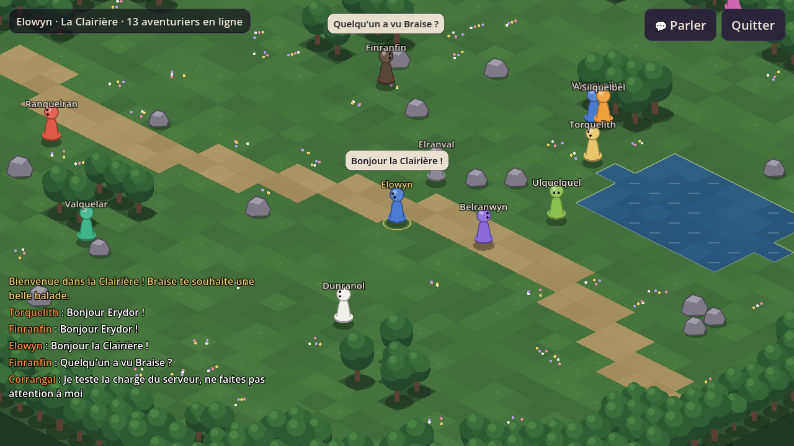

# 🐉 Lumenfall, les Chroniques d'Erydor

MMORPG 2D pour PC et téléphone, à vivre entre amis dans le monde d'Erydor.



- 📜 **Suivi du projet, décisions et notes de version :** [SUIVI.md](SUIVI.md)
- 📖 **La bible du monde :** [docs/bible-du-monde.md](docs/bible-du-monde.md)

## Organisation du dépôt

| Dossier | Contenu |
|---|---|
| `client/` | Le jeu (Godot 4.7, GDScript), avec le kit Nakama pour Godot |
| `server/` | Le module serveur en Go, chargé par Nakama : connexion Discord, héros, simulation du monde |
| `server/world/` | La simulation pure (cartes, collisions, trajets, noms), testée sans Nakama |
| `deploy/` | Recette Docker pour le serveur de test et le vrai serveur (Nakama, PostgreSQL, Caddy) |
| `tools/` | Générateur de la Clairière, forge des héros en pixel art (`tools/sprites/`), serveur local, faux joueurs |
| `docs/` | Bible du monde, captures et archives des questionnaires |

## Lancer en local

1. PostgreSQL 16 qui tourne, avec une base `nakama`.
2. Le binaire officiel de Nakama 3.41, et Go (la bonne version est choisie toute seule) :
   `NAKAMA=/chemin/vers/nakama tools/dev-server.sh`
3. Ouvrir `client/` dans Godot 4.7 et lancer. Le bouton « Connexion de test » marche sur ce serveur local.

## Tests

```sh
cd server && go test ./...                         # simulation, noms, connexion Discord
cd tools/loadbots && go run . -n 100 -duree 60s   # 100 faux joueurs
```

Captures automatiques du client (Linux, sans écran) :

```sh
xvfb-run godot --path client --rendering-driver opengl3 -- --capture=world --out=clairiere.png
```

## Redessiner les héros

Les planches du héros sont dessinées par un programme, pas à la main :

```sh
pip install numpy pillow
python3 tools/sprites/forge_heros.py --apercu   # environ 3 minutes
python3 tools/sprites/forge_heros.py --pieces robe chapeau   # seulement quelques pièces
python3 tools/sprites/forge_braise.py           # Braise, le petit dragon
```

## Les habitants

- Où ils travaillent, où ils dorment, s'ils sortent la nuit : `server/world/maps/glennmor.pnj.json` (le serveur vérifie au démarrage que ces lieux sont praticables et reliés).
- Leur tenue, leurs bulles et leurs dialogues : `client/data/pnj/glennmor.json`. Un dialogue est une suite de nœuds `{texte, choix: [{texte, vers}]}` qui commence à `debut` ; `vers` vide termine la conversation. `{nom}` est remplacé par le nom du héros.

## Le combat et les monstres

- Les règles (éléments, effets, Paladin, menace, mort, XP) : `server/world/combat.go` et `server/world/arena.go` ; le Grand Sanglier : `server/world/boss.go`.
- Le bestiaire (vie, dégâts, vitesse, butin) : `server/world/monster.go`. Où vivent les monstres : `server/world/maps/glennmor.monstres.json` (le serveur vérifie au démarrage que chaque camp est praticable).
- Les dessins des bêtes : `python3 tools/sprites/forge_betes.py` (environ 3 minutes), ou seulement quelques-unes : `python3 tools/sprites/forge_betes.py loup sanglier`.
- Capture d'un combat : `--capture=world --cible=sanglier --competences=1,5,roulade` (ajoute `--tactile` pour la disposition téléphone).

## Retoucher une carte

1. Premier jet (une seule fois) : `python3 tools/maps/gen_glennmor.py`, puis
   `godot --headless --path client --script res://outils/construire_carte.gd -- glennmor`.
2. Ouvrir `client/cartes/glennmor.tscn` dans Godot : peindre les terrains (chemin, pavés, eau, herbe grise) avec l'outil Terrains, glisser des décors depuis `client/cartes/decors/`.
3. Exporter pour le serveur : `godot --headless --path client --script res://outils/exporter_carte.gd -- glennmor`.

Attention : relancer l'étape 1 écrase les retouches faites à la main.

## Secrets

Les clés et mots de passe vivent dans un fichier `.env` sur le serveur, jamais dans ce dépôt. Modèle : `deploy/.env.example`.
