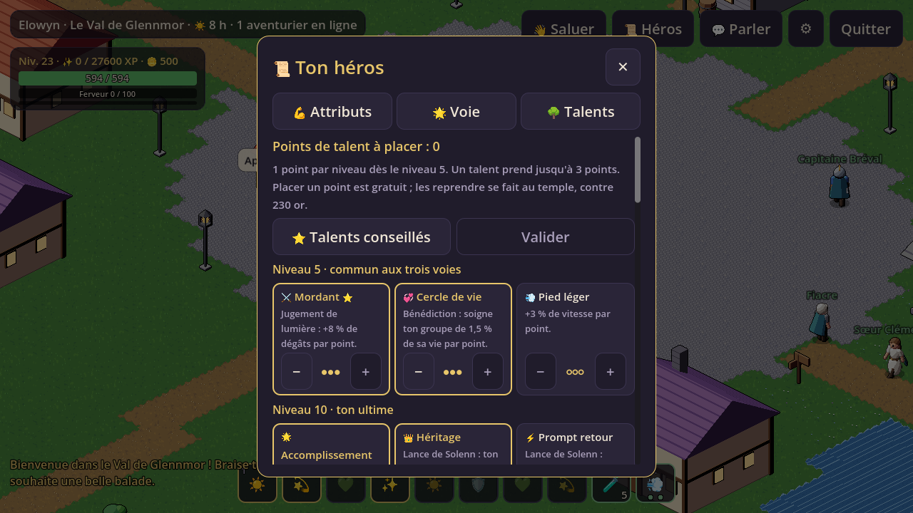
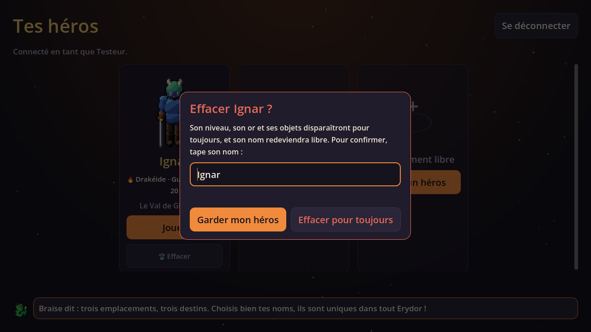

# 📜 Journal de quête de Lumenfall

*Le document de suivi du projet : ce qui est fait, ce qui reste, et les décisions prises. Mis à jour à chaque livraison.*

**Version actuelle :** V0.5.3 « Mille chemins » (5 novembre 2026) · **Acte en cours :** Acte V, objets, métiers et économie

---

## 🗺️ La grande carte des actes

| Acte | Nom | État |
|---|---|---|
| I | Les fondations : dépôt, serveur, base de données, connexion Discord, héros qui bougent ensemble, serveur de test | ✓ validé par Elowan |
| II | Le monde vivant : rendu HD-2D, héros en couches 8 directions, première région, jour / nuit, météo, PNJ | ✓ validé par Elowan |
| III | Le combat : ciblage, compétences, effets, éléments, monstres, boss, mort | ✓ validé par Elowan |
| IV | Les héros : 15 races, 17 classes, spécialisations, personnalisation | ✓ validé par Elowan |
| V | Objets, métiers et économie | ○ |
| VI | Social, guildes, PvP | ○ |
| VII | Donjons, raids, quêtes et histoire | ○ |
| VIII | Familiers, montures, maison, mini-jeux, événements | ○ |
| IX | Le monde complet, les 8 langues, le site, le bot | ○ |
| X | Alpha entre amis, bêta sur itch.io, 1.0 sur Steam | ○ |

---

## ⚒️ Acte I, les fondations

### ✓ Quêtes accomplies

- ✓ **Le Conseil des Fondations** : 21 questions de cadrage, toutes répondues le 29 octobre 2026 ([archive](docs/conseil-des-fondations.html)).
- ✓ **Le coffre du royaume** : dépôt `valcysbot/lumenfall` créé et branché.
- ✓ **La forge du serveur** : Nakama 3.41 + module Go + PostgreSQL. Le monde tourne à 10 calculs par seconde, et le serveur décide de tout (le client n'envoie que des intentions).
- ✓ **La Clairière** : carte de test de 40 × 40 cases (étang, rochers, bosquets, chemin), générée par `tools/gen_clairiere.py`.
- ✓ **Les héros** : 3 emplacements par compte, nom unique dans tout Erydor (accents et majuscules ignorés pour l'unicité), 12 couleurs de pion.
- ✓ **Le sceau de Discord (côté serveur)** : connexion OAuth2, testée avec un faux Discord. On garde uniquement l'identifiant, le pseudo et l'avatar.
- ✓ **La porte de test** : connexion sans Discord, refusée partout sauf sur le serveur de test.
- ✓ **Le premier pas** : client Godot 4.7, vue 3/4 isométrique, clic pour aller + ZQSD (AZERTY et QWERTY), joystick + toucher sur téléphone, noms au-dessus des têtes, chat général avec bulles.
- ✓ **L'épreuve des 100** : test de charge avec 100 faux joueurs pendant 70 s : 100/100 connectés, tick moyen **0,51 ms** sur les 100 ms disponibles, 86 Mo de mémoire.

- ✓ **Les builds** : Windows (zip) et Android (APK) construits par GitHub Actions à chaque changement.
- ✓ **Le serveur de test** : VPS Hostinger KVM 1 acheté par Elowan, installé par `deploy/bootstrap-vps.sh`, mis à jour automatiquement à chaque changement du serveur, avec un test de fumée (5 faux joueurs + porte Discord) après chaque déploiement.
- ✓ **Application Discord « Lumenfall »** créée par Elowan.

- ✓ **V0.1 entre amis** : Elowan + 2 ou 3 amis dans la Clairière, sur PC et Android.
- ✓ **Bousculade (V0.1.1)** : les héros ne se traversent plus.

### ⚠️ Points d'attention

- Le trafic sortant est d'environ 19 Ko/s par joueur avec 100 joueurs au même endroit. C'est acceptable pour l'Acte I ; à l'Acte II on n'enverra à chaque joueur que ce qui se passe près de lui.
- Ton propre héros suit le serveur avec environ 0,1 s de retard voulu, pour un mouvement fluide. Une « prédiction » locale (le héros réagit instantanément) est prévue pour V0.2.
- Le serveur de test utilise une adresse gratuite en `sslip.io` avec HTTPS par Caddy. Un vrai nom de domaine viendra avant l'alpha.
- L'APK Android est signé avec une clé de test : pour le Play Store, il faudra une vraie clé de signature (Acte X).

---

## 🌗 Acte II, le monde vivant

### ✓ Quêtes accomplies

- ✓ **Le Conseil du Monde vivant** : 25 questions, toutes répondues le 29 octobre 2026 ([archive](docs/conseil-du-monde-vivant.html)).
- ✓ **Le Grimoire d'Erydor** : la bible du monde, 31 pages validées par Elowan ([bible](docs/bible-du-monde.md), [version interactive](docs/grimoire-d-erydor.html)).

- ✓ **La fabrique des dessins** : l'IA d'images n'est pas accessible depuis l'environnement de Claude ; Elowan a choisi le pixel art dessiné par code.
- ✓ **La forge des héros** (`tools/sprites/forge_heros.py`) : un mannequin 3D photographié dans la vraie vue du jeu, pièce par pièce. 10 pièces (corps, pantalon, bottes, tunique en 12 couleurs, gants, cape, cheveux courts ou longs en 6 couleurs, casque, épée), 8 directions, 4 animations (repos, marche, course, salut).
- ✓ **Habits neufs (V0.1.2)** : le pion est remplacé par le héros en couches, avec la course, le salut et le zoom.
- ✓ **Bourg-Lanterne (V0.1.4)** : le Val de Glennmor (200 × 200 cases) remplace la Clairière. Bourg-Lanterne, sa place, son puits et son marché ; l'auberge La Chope Pleine et 2 maisons où l'on entre ; le temple de Solenn, la forge, le moulin, les fermes et le pré de Gwenn, la rivière et son pont, la Lisière Grise à l'est. Les lanternes s'allument la nuit.
- ✓ **La fabrique des cartes** : `forge_tuiles.py` (sol), `forge_decors.py` (36 décors), `gen_glennmor.py` (premier jet), puis `construire_carte.gd` en fait une scène Godot qu'on retouche à la souris, et `exporter_carte.gd` en tire les cases bloquées et les portes pour le serveur.
- ✓ **Le ciel d'Erydor (V0.1.3)** : jour et nuit sur 2 heures, la même heure pour tout le monde ; pluie, brouillard et orage décidés par le serveur pour chaque région ; torches automatiques la nuit ; réglage de luminosité de la nuit.

- ✓ **Les habitants (V0.2)** : 11 habitants de la bible vivent à Bourg-Lanterne, avec leurs horaires (le serveur les fait travailler le jour, rentrer dormir la nuit ; Corbin fait l'inverse). Bulles quand on passe, boîte de dialogue avec portrait et choix, Maître Mabon et son sanglier qui grandit. Braise vole derrière le héros et commente ce qu'il voit.

- ✓ **Clôture** : V0.2 sur le serveur de test et publiée (v0.2.0), validée par Elowan le 30 octobre 2026.

### ⚠️ Points d'attention

- **Nuits très sombres (choix d'Elowan)** : la torche s'allume toute seule la nuit, et un réglage de luminosité protège la lisibilité sur téléphone. Pour ménager les téléphones, seuls les 10 héros les plus proches portent une torche allumée.
- **Casque, gants et cape visibles (choix d'Elowan)** : presque deux fois plus de dessins par direction et par animation. Avec la forge par code, ça ne coûte que du temps de calcul (3 minutes pour tout redessiner).
- **Beaucoup de décors** : le val compte près de 7 000 décors (surtout des arbres). Godot n'affiche que ceux à l'écran, mais il faudra vérifier la fluidité sur ton téléphone ; si ça rame, on regroupera les forêts lointaines.
- **Héros de la Clairière** : la Clairière est fermée. Les héros qui y étaient réapparaissent sur la place de Bourg-Lanterne.
- **Cheveux tirés du nom** : en attendant la personnalisation de l'Acte IV, la coupe et la couleur des cheveux sont choisies à partir du nom du héros.
- **Habitants et maisons** : les habitants ne passent pas encore par les portes. Le soir, ils rentrent devant chez eux et disparaissent ; seul Maître Mabon vit à l'intérieur de son auberge.
- **Passer derrière une maison** : un héros (ou un habitant) caché derrière un toit n'est pas encore montré en silhouette. À prévoir.
- **Pixel art et écrans** : sur un écran qui n'est pas un multiple de 1280 × 720, les pixels du héros peuvent être de tailles un peu inégales. Le zoom le règle en partie ; un vrai réglage « pixels nets » viendra avec la V0.2.

---

## ⚔️ Acte III, le combat

### ✓ Quêtes accomplies

- ✓ **Le Conseil des Armes** : 25 questions, toutes répondues le 30 octobre 2026 ([archive](docs/conseil-des-armes.html)).
- ✓ **L'arène (serveur)** : `server/world/arena.go`. Le serveur décide de tout : portée, recharges, Ferveur, dégâts, critiques, esquive. Le client n'envoie que « je vise », « compétence 2 », « roulade », « bouclier », « potion ».
- ✓ **Les règles** (`server/world/combat.go`) : les 6 éléments en roue (feu > air > terre > eau > feu, lumière ↔ ombre, +50 %), 4 effets d'état (brûlure, poison, étourdissement, ralentissement), la menace pour les tanks, la mort au temple de Solenn avec 2 minutes de Faiblesse.
- ✓ **Le Paladin d'essai** : attaque de base automatique, Frappe sacrée, Coup de bouclier (étourdit), Lumière de Solenn (soin incanté), Aura de Solenn, Jugement de lumière (à distance, embrase). Ferveur, bouclier tenu au clic droit, roulade avec 2 charges d'endurance, 5 potions que Sœur Clémence remplit au village.
- ✓ **Le bestiaire du val** (`server/world/monster.go`, camps dans `maps/glennmor.monstres.json`) : sangliers (niv. 1 à 3), loups en meute (3 à 5), loups et corbeaux effacés dans la Lisière Grise (6 à 9), et le Sanglier doré qui fuit (3 % de chance). Ils flânent, remarquent les héros, appellent la meute et rentrent chez eux si l'on fuit trop loin. La nuit, les Effacés voient les torches de plus loin.
- ✓ **Le Grand Sanglier de Mabon** (`server/world/boss.go`), niveau 10, dans la Bauge au sud de la Lisière : charge et piétinement annoncés par des zones rouges ; sous la moitié de sa vie, la Flétrissure le dévore (phase 2 : il devient un Effacé, plus rapide, et des éclats gris tombent sur chaque héros).
- ✓ **XP et niveaux** : sans niveau maximum, la vie et les dégâts montent à chaque niveau ; or et trophées. Tout est sauvegardé en base avec la position.
- ✓ **La forge des bêtes** (`tools/sprites/forge_betes.py`) et 7 nouvelles animations du Paladin (attaque, coup de bouclier, garde, incantation, sort, roulade, chute) avec son écu.
- ✓ **Le tutoriel de combat** (V0.3.1, `client/scripts/combat_tutorial.gd`) : au premier monstre croisé, Braise apprend les gestes un par un (viser, frapper, bouclier, roulade, potion, autres sorts) en faisant briller le bon bouton. On peut le passer, et le revoir dans les réglages ⚙.
- ✓ **Les duels sur invitation** (V0.3.2, `server/world/duel.go`) : vise un héros, « Défier en duel » ; s'il accepte, un drapeau est planté entre vous et un cercle se dessine au sol. Après 3, 2, 1, les coups comptent. Personne ne meurt : le premier à 1 point de vie a perdu, sortir du cercle c'est abandonner, et au bout de 2 minutes c'est match nul.
- ✓ **Le combat à l'écran** : cadre du héros (vie, Ferveur, XP, effets), cadre de la cible, barre de compétences (1 à 5, R, Espace), éventail pour le pouce sur téléphone, chiffres qui sautent, critiques dorés qui font trembler l'écran, ralenti sur le coup fatal d'un élite, zones rouges qui se remplissent, écran « Tu es tombé ».
- ✓ **Clôture** : V0.3.2 sur le serveur de test et publiée, Acte III validé par Elowan le 2 novembre 2026.

### ○ À suivre

- ○ Les réglages au fil des parties (vie des monstres, dégâts, temps de recharge) : dis-moi ce qui est trop dur ou trop mou.

### ⚠️ Points d'attention

- **Équilibrage à l'aveugle** : les chiffres viennent de calculs et de tests automatiques, pas encore de vraies parties. Attends-toi à ce que certains monstres soient trop durs ou trop mous : dis-moi lesquels.
- **Tout le monde est Paladin** jusqu'à l'Acte IV : les héros existants ont reçu l'écu et les compétences du Paladin.
- **Le Grand Sanglier se joue à plusieurs** : seul au niveau 10, il faut absolument sortir des zones rouges (dans les combats simulés sans esquive, le héros seul perd 10 fois sur 10). À deux ou trois, ça passe. Il revient 5 minutes après sa chute.
- **L'équilibrage simulé** (`server/world/equilibre_test.go`) : 10 combats automatiques par camp vérifient qu'un Paladin du bon niveau gagne contre sangliers, loups, loups et corbeaux effacés. Le soin a reçu 6 s de recharge : sans elle, le Paladin était immortel.
- **Planches plus larges** : le héros est maintenant dessiné sur des images de 64 pixels de large (pour la chute), et chaque planche fait 3 712 pixels de large. C'est sous la limite de 4 096 des téléphones, mais il faudra découper les planches quand les animations des 17 classes arriveront.
- **Jeu trop ancien** : le serveur demande au moins la v0.3.0. La v0.3.1 n'ajoute que le tutoriel : une v0.3.0 peut toujours jouer.
- **Le ralenti** n'existe que sur ton écran (le monde est partagé) : il ne dure qu'une demi-seconde, sur le coup fatal d'un élite ou d'un boss.

## 🧝 Acte IV, les héros

### ✓ Quêtes accomplies

- ✓ **Le Conseil des Héros** : 40 questions en 7 chapitres, toutes répondues le 2 novembre 2026 ([archive](docs/conseil-des-heros.html)).
- ✓ **La forge des peuples** (`tools/sprites/forge_peuples.py`, données dans `tools/sprites/peuples.py`) : 116 planches pour les 15 races. Trois corps (chair, pierre pour les Golems, cristal pour les Lumins) en 3 carrures, 16 visages, 6 marques, 16 traits (oreilles, cornes, bois, défenses, ailes, queues, nageoires, mousse, éclats), 20 coupes, 6 barbes, les habits et 20 armes, plus l'animation « tir ». Les planches ne portent pas de couleurs : un petit shader les teint (24 peaux par race, 12 yeux, 24 couleurs de cheveux, 12 tuniques). Planches de 32 images de large, sous la limite des téléphones.
- ✓ **Le miroir de création** (`client/scripts/miroir.gd`) : peuple (par faction, avec son blason), homme / femme / autre et les accords (il, elle, iel), taille en 5 crans et carrure, visage, peau, yeux, cheveux, barbe, marques empilées (3 au plus), tunique, classe (avec ses compétences et ses voies), dieu, Hardcore, nom. Le reflet tourne sur lui-même ; les Fées flottent.
- ✓ **Le miroir de Solenn** : près de Sœur Clémence, le bouton 🪞 Miroir rouvre le miroir pour changer d'allure. Le premier passage est offert, ensuite 50 or.
- ✓ **Les 17 classes** (`server/world/classes.go`, moteur dans `server/world/skills.go`) : chacune sa ressource, ses armes et 7 compétences (niveaux 1 à 9), plus l'ultime de sa voie sur la touche 8. 22 effets (gel, saignement, silence, peur, charme, bouclier, régénération, furtivité, rage, provocation, compagnons…). Les compagnons (squelettes, esprits, tourelles, dragonneau, meute) frappent la cible du héros.
- ✓ **Les 51 voies** : au niveau 10, l'épreuve de la voie (vaincre 5 Effacés), puis le choix dans la fiche du héros. Chaque voie donne un bonus permanent et son ultime. On peut en changer au temple contre 20 or par niveau.
- ✓ **Les 9 attributs** : 5 points par niveau, bouton ⭐ « Répartition conseillée », tout se redistribue gratuitement jusqu'au niveau 10. Chaque peuple a son petit bonus (+1 dans un attribut, ou un peu de résistance à un élément ; les Humains ont +1 en Chance).
- ✓ **La gloire** : une aura discrète aux couleurs du dieu, qui grandit tous les 10 niveaux ; le blason de faction devant le nom ; la fiche publique d'un héros (« 📜 Sa fiche » dans le cadre de la cible).
- ✓ **Hardcore** : une seule vie. Le héros tombé est effacé de la base, tout le monde l'apprend dans le chat, et le joueur revient à l'écran des héros.
- ✓ **Nouveau départ** : les héros d'avant l'Acte IV sont effacés au premier démarrage du serveur V0.4 (choix d'Elowan). Le serveur demande au moins la v0.4.0.
- ✓ **Effacer un héros** (V0.4.1, demande d'Elowan) : un bouton 🗑️ « Effacer » sous chaque héros. Pour confirmer, on retape son nom ; le serveur le vérifie aussi. L'emplacement et le nom redeviennent libres.
- ✓ **L'équilibrage simulé des 17 classes** (`server/world/equilibre_test.go`) : 10 combats automatiques par camp et par classe ; chaque classe bat ses sangliers au niveau 1 au moins 8 fois sur 10, et les loups, loups effacés et corbeaux effacés aux bons niveaux.

- ✓ **Le Conseil des Talents** : 27 questions en 5 chapitres, toutes répondues le 2 novembre 2026 ([archive](docs/conseil-des-talents.html)).
- ✓ **Les talents** (V0.5, `server/world/talents.go`) : un arbre par voie, 10 rangées (niveaux 5, 10, 15… 50), 3 talents par rangée (seul, groupe, utilitaire), jusqu'à 3 points par talent, 1 point par niveau dès le niveau 5 (46 points au niveau 50). La rangée du niveau 5 est commune aux 3 voies de la classe ; celle du niveau 10 transforme l'ultime. 1 428 talents en tout, chacun avec sa phrase, ses chiffres exacts et son émoji. Placer un point est gratuit ; les reprendre se fait au temple, contre 10 or par niveau. Changer de voie ne vide que la partie de la voie.
- ✓ **L'onglet 🌳 Talents** dans la fiche du héros, le bouton ⭐ « Talents conseillés » et une ⭐ par rangée. Quand une rangée s'ouvre, Braise le dit et le bouton de la fiche s'allume (✦) jusqu'au choix. Les talents se voient sur la fiche publique et comptent tels quels en duel.
- ✓ **L'équilibrage simulé des talents** (`server/world/talents_test.go`) : pour chaque voie, un héros niveau 50 avec les talents conseillés frappe un mannequin pendant 60 s ; la force de chaque arbre est réglée (`talents_echelle.go`) pour que les talents donnent environ +15 %. Les 51 voies tombent entre +13 % et +21 %.
- ✓ **Les formes de combat** : en combat, le Druide de la voie Forme d'ours devient un ours, celui de la Forme de lynx un lynx, et l'Ingénieur Pilote d'armure monte dans son armure à vapeur (8 directions, `tools/sprites/forge_betes.py`). Hors combat, le héros revient.
- ✓ **Les habitants redessinés** avec la forge des peuples : chacun a son allure (carrure, peau, coupe, barbe, visage) et ses pièces (tablier, cape, casque, chapeau de paille, armes), en jeu et dans le portrait du dialogue.

### ✱ Quêtes en cours

- ✓ **La soirée de jeu entre amis** avec les talents, et ses retours corrigés en V0.5.1, V0.5.2 et V0.5.3. Acte IV validé par Elowan le 5 novembre 2026.

### 🗡️ Les 51 voies

| Classe | Ressource | Voies |
|---|---|---|
| Guerrier | Rage | Rempart 🛡️ · Gladiateur ⚔️ · Champion ⚔️ |
| Berserker | Furie | Sang-bête ⚔️ · Briseur ⚔️ · Inébranlable 🛡️ |
| Lancier | Élan | Hallebardier ⚔️ · Javelinier ⚔️ · Sentinelle 🛡️ |
| Chevalier-dragon | Souffle draconique | Écaille 🛡️ · Souffle ⚔️ · Lien du dragonneau ⚔️ |
| Paladin | Ferveur | Bouclier de l'Aube 🛡️ · Héraut 🎺 · Croisé ⚔️ |
| Moine | Souffle intérieur | Poing de vent ⚔️ · Brume sereine 💚 · Pilier 🛡️ |
| Mage | Mana | Pyromancien ⚔️ · Givremage ⚔️ · Tempêtier ⚔️ |
| Nécromancien | Âmes | Maître des Os ⚔️ · Moissonneur ⚔️ · Passeur 💚 |
| Invocateur | Lien | Démoniste ⚔️ · Dresseur de chimères ⚔️ · Lieur d'éléments ⚔️ |
| Alchimiste | Réactifs | Apothicaire 💚 · Artificier ⚔️ · Empoisonneur ⚔️ |
| Ingénieur | Vapeur | Artilleur ⚔️ · Bâtisseur de tourelles ⚔️ · Pilote d'armure 🛡️ |
| Prêtre | Grâce | Oracle 💚 · Veilleur 💚 · Prêtre du Silence 🎺 |
| Druide | Sève | Forme d'ours 🛡️ · Forme de lynx ⚔️ · Cœur de la forêt 💚 |
| Chaman | Esprits | Voix des orages ⚔️ · Source vive 💚 · Marcheur des esprits ⚔️ |
| Barde | Harmonie | Conteur 🎺 · Virtuose ⚔️ · Troubadour 💚 |
| Voleur / assassin | Énergie | Assassin ⚔️ · Bretteur ⚔️ · Ombrelame ⚔️ |
| Archer | Concentration | Tireur d'élite ⚔️ · Rôdeur ⚔️ · Trappeur ⚔️ |

🛡️ tank · 💚 soin · ⚔️ dégâts · 🎺 soutien. Bilan : 8 voies de tank, 8 de soin, 3 de soutien, 32 de dégâts.

### ⚠️ Points d'attention

- **Une seule grosse livraison** (choix d'Elowan) : les 17 classes et les 15 races arrivent ensemble dans la V0.4. Il faudra donc plus de temps qu'entre les versions précédentes avant de pouvoir jouer, et le premier équilibrage portera sur 17 classes d'un coup.
- **Le Paladin n'a plus de voie de soin** : avec Bouclier de l'Aube, Héraut et Croisé, chaque voie garde Lumière de Solenn (le soin) et l'aura, mais aucune n'est spécialisée dans le soin du groupe.
- **Hardcore sans filet** (choix d'Elowan) : un héros hardcore qui meurt est supprimé pour de bon.
- **Beaucoup de dessins** : 16 visages × 24 teintes × 20 coupes × 24 couleurs par race. La forge par code les fabrique pièce par pièce (les couleurs sont des teintures de palette), mais les planches devront être découpées pour tenir sous 4 096 pixels sur téléphone.
- **Fées très petites** : à 60 %, une Fée fait environ 19 pixels de haut ; son nom et son cercle de sélection restent à la taille normale pour qu'on puisse la viser.
- **Équilibrage à l'aveugle, puissance 17** : les chiffres viennent des combats simulés, pas de vraies parties. Seul contre le Grand Sanglier, les classes qui se soignent ou se drainent (Paladin, Prêtre, Druide, Nécromancien, Alchimiste, Moine) gagnent presque toujours, alors que la plupart des classes de dégâts perdent : c'est voulu pour un boss de groupe, mais dis-moi ce que vous en pensez.
- **Deux retouches après les simulations** : la Frappe héroïque du Guerrier rend 40 % de ses dégâts en vie, et la Lumière de Solenn du Paladin s'apprend dès le niveau 1 (le Coup de bouclier passe au niveau 2). Sans ça, ces deux classes perdaient trop souvent contre les sangliers.
- **Homme, femme, autre** : le choix change les accords du jeu (« tombé », « tombée », « tombé·e ») et les noms (Guerrière, Elfe noire…), pas encore la silhouette ; les carrures et les coupes font la différence à l'écran.
- **Compagnons simplifiés** : les compagnons sont une petite créature qui tourne autour du héros, pas encore un monstre à part entière.
- **Des talents chiffrés tout petits** : 15 % répartis sur 46 points, ça fait peu par point. Pour 9 voies, les bonus chiffrés sont tombés au plancher (+1 % par point) et ce sont surtout les talents qui changent les compétences (cibles en plus, effets, ultime transformé) qui pèsent. Si vous trouvez les talents fades, on peut monter la cible à 20 ou 25 %.
- **La survie n'est pas mesurée** : l'équilibrage compte les dégâts et les soins, pas la vie gagnée ni les dégâts évités. Les talents de tank et utilitaires sont réglés à l'œil.
- **La Forme d'ours de dos** ressemble à une grosse silhouette brune : lisible, mais c'est l'angle le moins réussi des trois formes.
- **Fluidité, retour d'Elowan (V0.5)** : « ça bug, ce n'est pas aussi fluide que voulu ». Le serveur va bien (0,9 ms par tick avec 30 faux joueurs, sur 100 ms). La V0.5.1 rend les mouvements plus réguliers et ajoute le compteur de fluidité ; reste à savoir sur quel appareil ça saccade (le Val compte environ 7 000 décors, plus lourds pour un téléphone).
- **Il faut la v0.5.0** pour entrer dans le monde : les anciens jeux ne savent pas afficher les talents.
- **Effacer, c'est pour toujours** : il n'y a pas de corbeille. Si le héros est encore en jeu sur un autre appareil, il continue jusqu'à sa déconnexion, puis disparaît.
- **Hardcore** : l'effacement est testé dans les simulations et sur un serveur local, pas encore avec une vraie mort sur le serveur de test.

---

## ⚖️ Décisions prises

| Date | Décision | Choix |
|---|---|---|
| 29/10/2026 | Moteur du client | Godot 4 (GDScript), kit officiel Nakama |
| 29/10/2026 | Serveur | Nakama + modules Go + PostgreSQL |
| 29/10/2026 | Hébergement pendant l'Acte I | Développement en local, petit VPS de test seulement pour la V0.1 ⭐ |
| 29/10/2026 | Région du serveur | Europe (France, Allemagne ou Pays-Bas) ⭐ |
| 29/10/2026 | Rythme du monde | 10 calculs par seconde ⭐ |
| 29/10/2026 | Sauvegarde du héros | Toutes les 30 s et à la déconnexion ⭐ |
| 29/10/2026 | Application Discord | Nouvelle application « Lumenfall » ⭐ |
| 29/10/2026 | Connexion de test | Oui, seulement sur le serveur de test ⭐ |
| 29/10/2026 | Données Discord gardées | Identifiant, pseudo et avatar ⭐ |
| 29/10/2026 | Héros par compte | 3 emplacements dès maintenant ⭐ |
| 29/10/2026 | Vue | 3/4 isométrique dès l'Acte I ⭐ |
| 29/10/2026 | Allure du héros (Acte I) | Pion propre et provisoire ⭐ |
| 29/10/2026 | Carte de test | Clairière avec obstacles ⭐ |
| 29/10/2026 | Déplacement PC | Clic + ZQSD ⭐ |
| 29/10/2026 | Déplacement téléphone | Joystick + toucher ⭐ |
| 29/10/2026 | Création du héros (Acte I) | **Nom + couleur de pion** (choix d'Elowan) |
| 29/10/2026 | Voir les autres | Noms + chat général avec bulles ⭐ |
| 29/10/2026 | Test de charge | 100 faux joueurs ⭐ |
| 29/10/2026 | Livraison PC | Zip Windows sur GitHub, en privé ⭐ |
| 29/10/2026 | Livraison Android | APK à installer à la main ⭐ |
| 29/10/2026 | Testeurs de l'Acte I | **Elowan + 2 ou 3 amis dès les premières versions** (choix d'Elowan) |
| 29/10/2026 | Notes de mise à jour | Une petite note chaque jour de travail ⭐ |
| 29/10/2026 | Journal de suivi | Ce fichier, dans le dépôt ⭐ |
| 29/10/2026 | Fabrication des dessins | IA + nettoyage en pixel art ⭐, impossible faute d'accès à une IA d'images |
| 29/10/2026 | Fabrication des dessins (bis) | Pixel art dessiné par code ⭐ |
| 29/10/2026 | Palette | Vive et colorée, façon Aion ⭐ |
| 29/10/2026 | Contour des sprites | Fin contour sombre ⭐ |
| 29/10/2026 | Effets HD-2D | Lumière dynamique + ombres + léger flou de profondeur ⭐ |
| 29/10/2026 | Zoom | Réglable dans une petite plage ⭐ |
| 29/10/2026 | Races dessinées à l'Acte II | Humain seulement ⭐ |
| 29/10/2026 | Pièces visibles | **Corps, tête, cheveux, torse, jambes, bottes, arme + casque, gants, cape** (choix d'Elowan) |
| 29/10/2026 | Animations | Marche, course, repos, salut ⭐ |
| 29/10/2026 | Course | Marche par défaut, touche ou bouton pour courir ⭐ |
| 29/10/2026 | Pion de l'Acte I | Remplacé pour de bon ⭐ |
| 29/10/2026 | Paysage de départ | Forêts et prairies ⭐ |
| 29/10/2026 | Taille de la première région | Environ 200 × 200 cases ⭐ |
| 29/10/2026 | Cœur de la région | Un village d'accueil ⭐ |
| 29/10/2026 | Bâtiments où l'on entre | L'auberge et 2 maisons ⭐ |
| 29/10/2026 | Construction des cartes | Éditeur de tuiles de Godot ⭐ |
| 29/10/2026 | Durée d'une journée | 2 h réelles (80 min de jour, 40 de nuit) ⭐ |
| 29/10/2026 | La nuit | **Très sombre, il faut une torche** (choix d'Elowan) |
| 29/10/2026 | Météo de l'Acte II | Pluie, brouillard, orage ⭐ |
| 29/10/2026 | Saisons | Plus tard, à l'Acte VIII ⭐ |
| 29/10/2026 | Météo partagée | Oui, par région, décidée par le serveur ⭐ |
| 29/10/2026 | Nombre de PNJ | Une dizaine, avec leurs habitudes ⭐ |
| 29/10/2026 | PNJ d'accueil | **Un aubergiste bavard** (choix d'Elowan) : Maître Mabon |
| 29/10/2026 | Dialogues | **Bulles en passant + boîte quand on parle** (choix d'Elowan) |
| 29/10/2026 | Vie des PNJ | Ils dorment la nuit et ouvrent boutique le jour ⭐ |
| 29/10/2026 | Braise dans le jeu | Il suit le héros et commente, désactivable ⭐ |
| 29/10/2026 | Bible du monde | Les 31 pages du Grimoire d'Erydor validées ⭐ |
| 29/10/2026 | 15ᵉ race | **Les Lumins**, êtres de cristal nés du Lumenfall (choix d'Elowan) |
| 30/10/2026 | Ciblage | Clic sur le monstre ou Tab ⭐ |
| 30/10/2026 | Attaque de base | Automatique sur la cible, les compétences à la main ⭐ |
| 30/10/2026 | Bouger en combattant | Oui, sauf pendant une incantation ⭐ |
| 30/10/2026 | Roulade | **Jauge d'endurance : 2 roulades d'affilée** (choix d'Elowan) |
| 30/10/2026 | Combat sur téléphone | Éventail de 5 compétences + roulade + cible suivante ⭐ |
| 30/10/2026 | Classe d'essai | Le Paladin seul, très soigné ⭐ |
| 30/10/2026 | Compétences | 5 : frappe, coup de bouclier, soin, aura, jugement ⭐ |
| 30/10/2026 | Ressource du Paladin | La Ferveur ⭐ |
| 30/10/2026 | Bouclier | Tenu au clic droit, bloque de face ⭐ |
| 30/10/2026 | Potions | 5, recharge de 30 s, remplies par Sœur Clémence ⭐ |
| 30/10/2026 | Effets d'état | 4 : brûlure, poison, étourdissement, ralentissement ⭐ |
| 30/10/2026 | Éléments | Les 6, en roue, +50 % ⭐ |
| 30/10/2026 | Chiffres de dégâts | Qui sautent, critiques dorés avec tremblement ⭐ |
| 30/10/2026 | Ralenti | Seulement sur le coup fatal d'un élite ou d'un boss ⭐ |
| 30/10/2026 | Attaques annoncées | Zones rouges qui se remplissent ⭐ |
| 30/10/2026 | Premiers monstres | Bêtes du val + leurs versions effacées vers la Lisière ⭐ |
| 30/10/2026 | Sortes de monstres | 4 + le Sanglier doré ⭐ |
| 30/10/2026 | Comportement | Ils flânent, attaquent de près, rentrent si l'on fuit ⭐ |
| 30/10/2026 | Premier boss | Le Grand Sanglier de Mabon, 2 phases ⭐ |
| 30/10/2026 | Menace | Dès maintenant ⭐ |
| 30/10/2026 | Mort | Temple de Solenn + Faiblesse 2 min ⭐ |
| 30/10/2026 | XP et niveaux | Dès l'Acte III, niveaux 1 à 10 dans le val ⭐ |
| 30/10/2026 | Butin | Or + trophées rares ⭐ |
| 30/10/2026 | PvP | Duels sur invitation juste après le boss ⭐ |
| 30/10/2026 | Mode hardcore | À l'Acte IV, avec la création du héros ⭐ |
| 30/10/2026 | Combat jugé « un peu compliqué » : ce qui manque | « On ne comprend pas quoi faire » → tutoriel de Braise au premier monstre ⭐ |
| 30/10/2026 | Publication des versions | Claude lance lui-même la publication (onglet Actions) après chaque fusion |
| 03/11/2026 | Acte suivant | Dès qu'un acte est clos, Claude ouvre tout seul le fil de l'acte suivant |
| 02/11/2026 | Genre | Homme, femme ou autre, avec choix des accords ⭐ |
| 02/11/2026 | Silhouette | Taille (5 crans) + carrure (3) ⭐ |
| 02/11/2026 | Visage, peau, yeux | **16 visages, 24 teintes, marques en couches** (choix d'Elowan) |
| 02/11/2026 | Cheveux | **20 coupes, 24 couleurs, barbes et moustaches** (choix d'Elowan) |
| 02/11/2026 | Changer d'apparence | Miroir de Solenn : 1ʳᵉ fois gratuite, puis un peu d'or ⭐ |
| 02/11/2026 | Races dans la V0.4 | Les 15 ⭐ |
| 02/11/2026 | Tailles des peuples | De 70 % à 120 %, **et même 60 %** (précision d'Elowan) ⭐ |
| 02/11/2026 | Ailes des Fées | **Elles flottent toujours un peu au-dessus du sol** (choix d'Elowan) |
| 02/11/2026 | Sirènes et tritons | Jambes sur terre, queue dans l'eau ⭐ |
| 02/11/2026 | Revenants | Peau pâle bleutée, yeux qui luisent, flammes d'âme ⭐ |
| 02/11/2026 | Faction | Blason à côté du nom, le val reste neutre ⭐ |
| 02/11/2026 | Arrivée des classes | **Les 17 d'un coup** (choix d'Elowan) |
| 02/11/2026 | Compétences | 8 par classe, dont une ultime au niveau 10 ⭐ |
| 02/11/2026 | Ressources | Une par classe, 17 en tout ⭐ |
| 02/11/2026 | Spécialisation | Au niveau 10 après une quête de classe, changeable au temple contre de l'or ⭐ |
| 02/11/2026 | Attributs | 5 points par niveau, répartition conseillée, remise à zéro gratuite jusqu'au niveau 10 ⭐ |
| 02/11/2026 | Talents | À la fin de l'Acte IV ⭐ |
| 02/11/2026 | Les 51 voies | Voir le tableau de l'Acte IV : 7 trios ⭐, 10 trios choisis ou retouchés par Elowan |
| 02/11/2026 | Héros existants | **Tout est effacé, nouveau départ pour tous** (choix d'Elowan) |
| 02/11/2026 | Mort en hardcore | **Le héros est supprimé** (choix d'Elowan) |
| 02/11/2026 | Dieu servi | À la création, pour l'allure et les textes ⭐ |
| 02/11/2026 | Aura | Discrète, grandit tous les 10 niveaux ⭐ |
| 02/11/2026 | Fiche du héros | En jeu dès l'Acte IV ⭐ |
| 02/11/2026 | Forme des talents | **Un arbre par voie, avec des points à répartir** (choix d'Elowan) |
| 02/11/2026 | Ouverture | Une rangée tous les 5 niveaux, dès le niveau 5 ⭐ |
| 02/11/2026 | Rangées | **10 rangées, niveaux 5 à 50** (choix d'Elowan) |
| 02/11/2026 | Changer ses talents | **Contre de l'or au temple** (choix d'Elowan) |
| 02/11/2026 | Jeux de talents | **Un seul** (choix d'Elowan) |
| 02/11/2026 | Changer de voie | Seule la partie de la voie se vide ⭐ |
| 02/11/2026 | Ce que font les talents | Ils changent les compétences, avec quelques bonus chiffrés ⭐ |
| 02/11/2026 | Poids des talents | Environ +15 % ⭐ |
| 02/11/2026 | Les 3 choix d'une rangée | Seul, groupe, utilitaire ⭐ |
| 02/11/2026 | Ultime | La rangée de la voie transforme l'ultime ⭐ |
| 02/11/2026 | Nouveau bouton | Non, les 8 compétences restent ⭐ |
| 02/11/2026 | Talents en duel | **Tels quels** (choix d'Elowan) |
| 02/11/2026 | Talents visibles | Sur la fiche publique ⭐ |
| 02/11/2026 | Écran | 3ᵉ onglet 🌳 Talents ⭐, ⭐ Talents conseillés ⭐, phrase et chiffres exacts ⭐, émojis ⭐ |
| 02/11/2026 | Rangée qui s'ouvre | Braise le dit et la fiche s'allume ⭐ |
| 02/11/2026 | Équilibrage des talents | Simulations, puis vos impressions en jeu ⭐ |
| 02/11/2026 | Vos retours | **Tu me les écris ici** (choix d'Elowan) |
| 02/11/2026 | Paladin sans voie de soin | **On garde : le Prêtre et le Druide soignent** (choix d'Elowan) |
| 02/11/2026 | Formes de combat | Ours, lynx, armure à vapeur dessinés en 8 directions ⭐ |
| 02/11/2026 | Habitants | Redessinés avec la forge des peuples ⭐ |
| 02/11/2026 | Livraison | Les talents des 17 classes dans la V0.5 ⭐ |
| 02/11/2026 | Mort hardcore | **Déjà vérifiée par Elowan : « c'est niquel »** |
| 02/11/2026 | Validation de l'Acte IV | Après une soirée de jeu entre amis et les retours corrigés ⭐ |
| 02/11/2026 | Nom de la V0.5 | « Mille chemins » ⭐ |
| 05/11/2026 | La flèche vers la prochaine étape | **Retirée, elle n'aidait pas** (retour d'Elowan) ; le panneau 🎯 reste |
| 05/11/2026 | Cible automatique | Le monstre qui te frappe devient ta cible, sauf si ta cible se bat déjà contre toi ⭐ |

⭐ = recommandation de Claude suivie.

---

## 📦 Notes de version

### V0.5.3 · « Mille chemins » (5 novembre 2026)

Les derniers retours de l'Acte IV :

- 🖱️ **Toutes tes touches** : dans ⚙ Réglages → « Changer mes touches », une action peut aller sur une touche du clavier, un bouton de la souris (clic droit, molette, boutons 4 et 5…) ou un bouton de manette. Seul le clic gauche reste réservé (marcher et viser). Le bouclier devient une action comme les autres (clic droit par défaut), et le stick gauche d'une manette fait marcher ton héros. Les aides du tutoriel affichent tes touches à toi.
- 🎯 **La cible suit le combat** : si tu avais choisi un monstre et qu'un autre t'attaque, tu passes sur celui qui te frappe, sans Tab. Si ta cible se bat déjà contre toi, elle reste.
- 🧭 **La flèche dorée est retirée** : elle n'aidait pas. Le panneau 🎯 de la prochaine étape reste.

Capture : [les touches, avec la souris et la manette](docs/captures/v0.5.3/touches.png).

### V0.5.2 · « Mille chemins » (3 novembre 2026)

Les retours de la première soirée de jeu entre amis :

- 🎯 **La prochaine étape** : sous les boutons, le jeu te dit quoi faire selon ton niveau (sangliers, loups, Lisière Grise, épreuve de la voie, Grand Sanglier), et une flèche dorée autour de ton héros montre la direction.
- 🐗 **Des monstres plus vivants** : le sanglier charge, les loups bondissent sur leur proie, les corbeaux effacés piquent du ciel. Chaque coup s'annonce au sol et en toutes lettres (« Charge ! ») : roule pour l'éviter. Entre deux morsures, les loups et les corbeaux tournent autour de toi au lieu de rester plantés.
- ⚔️ **Face à face** : les héros et les monstres se tournent vers leur cible quand ils frappent. Le serveur le faisait déjà, mais ne l'envoyait pas quand personne ne bougeait : les coups semblaient partir de dos.
- 🎯 **La cible toute seule** : un monstre qui t'attaque devient ta cible si tu n'en avais pas, et quand elle tombe, tu passes à celui qui te frappe encore.
- ⌨ **Tes touches** : ⚙ Réglages → « Changer mes touches ». Si une touche était déjà prise, les deux actions échangent. Les flèches marchent toujours.
- 🐛 **Les boutons + et Valider** de la fiche ne répondaient plus quand ta vie ou ta ressource bougeait (la fiche se redessinait sous ton doigt, et les talents placés s'effaçaient). Corrigé.

Captures : [la prochaine étape](docs/captures/v0.5.2/prochaine-etape.png) · [la flèche](docs/captures/v0.5.2/fleche.png) · [les touches](docs/captures/v0.5.2/touches.png).

### V0.5.1 · « Mille chemins » (3 novembre 2026)

- 🧥 **La cape dans le dos** : vue de dos, la cape passe enfin devant le corps, au lieu de faire un bavoir. Pareil pour la queue des Drakéides et des Félins, les ailes des Fées et les nageoires.
- 🏃 **Des héros plus fluides** : le jeu replace les nouvelles du serveur à intervalles réguliers, et garde un peu plus d'avance (0,17 s au lieu de 0,11 s). Un message en retard ne fait plus s'arrêter puis sauter les héros. Sur un réseau irrégulier simulé, les à-coups passent d'environ 30 % à 20 %.
- 📶 **⚙ Réglages → « Afficher la fluidité »** : les images par seconde de ton écran et la régularité du réseau, à côté de l'heure. Pratique pour me dire ce qui coince.

### V0.5 · « Mille chemins » (3 novembre 2026)

- 🆕 **Les talents !** Dès le niveau 5, chaque niveau te donne un point de talent. Ouvre ta fiche (touche C), onglet 🌳 **Talents** : 10 rangées, une tous les 5 niveaux, 3 talents par rangée et jusqu'à 3 points par talent. Un talent pour jouer seul, un pour le groupe, un pour bouger ou survivre.
- 🆕 **Ton ultime change** : la rangée du niveau 10 le transforme à ta façon.
- 🆕 **⭐ Talents conseillés** : un bouton qui place tes points pour toi, et une ⭐ sur le talent conseillé de chaque rangée.
- 🆕 Quand une rangée s'ouvre, **Braise te prévient** et le bouton de ta fiche s'allume (✦).
- 🆕 Placer un point est gratuit ; pour en reprendre, passe au **temple de Solenn** (10 or par niveau).
- 🐻 **Les formes de combat** : en combat, le Druide devient ours ou lynx, et l'Ingénieur monte dans son armure à vapeur.
- ✨ **Les habitants ont une nouvelle allure**, dessinés comme vos héros : le tablier de Mabon, le casque du Capitaine Bréval, le chapeau de paille de Gwenn…
- 📜 Les talents se voient sur la fiche publique des autres héros.
- ⚠️ Il faut la v0.5.0 pour entrer dans le monde.

Captures : [la forme d'ours](docs/captures/v0.5/forme-d-ours.png) · [l'ours, le lynx et l'armure à vapeur](docs/captures/v0.5/les-formes.png) · [les habitants sur la place](docs/captures/v0.5/les-habitants.png) · [Aëlis dans son nouveau portrait](docs/captures/v0.5/aelis.png).

### V0.4.1 · « Mille visages » (2 novembre 2026)

- 🗑️ **Effacer un héros** : un bouton sous chaque héros de l'écran de choix. On retape son nom pour confirmer, et l'emplacement se libère pour un nouveau destin.

### V0.4 · « Mille visages » (2 novembre 2026)

- 🆕 **Le miroir de création !** 15 peuples, 17 classes, et ton héros à toi : taille, carrure, visage, peau, yeux, coupe, couleur de cheveux, barbe et moustache, marques empilées, tunique. Homme, femme ou autre, et tu choisis comment le jeu parle de toi : il, elle ou iel.
- 🆕 **17 classes, 8 compétences chacune** (touches 1 à 8 ; sur téléphone, deux rangées d'éventail). Chaque classe a sa ressource : la Rage du Guerrier, la Furie du Berserker, les Âmes du Nécromancien, la Vapeur de l'Ingénieur, l'Harmonie du Barde…
- 🆕 **Les voies** : au niveau 10, vaincs 5 Effacés, puis choisis l'une des 3 voies de ta classe et son **ultime** (touche 8).
- 🆕 **📜 Ta fiche** (touche C) : place tes 5 points par niveau dans les 9 attributs, ou laisse faire la ⭐ répartition conseillée.
- 🆕 **Ton dieu et ta faction** : une aura à ses couleurs qui grandit tous les 10 niveaux, et le blason de ta faction devant ton nom. « 📜 Sa fiche » montre celle des autres héros.
- 🆕 **💀 Hardcore** : une seule vie. Si tu tombes, ton héros est effacé pour toujours.
- 🆕 **Le miroir de Solenn**, près de Sœur Clémence : change d'allure (gratuit la première fois, puis 50 or).
- ✨ Les Fées flottent, les Revenants ont des flammes d'âme, les Lumins brillent doucement, et les compagnons tournent autour de leur maître.
- ⚠️ **Nouveau départ** : tous les héros d'avant sont effacés. Il faut la v0.4.0 pour entrer dans le monde.

Captures : [le miroir de création](docs/captures/v0.4/miroir.png) · [les 15 peuples](docs/captures/v0.4/quinze-peuples.png) · [quatre héros sur la place](docs/captures/v0.4/groupe.png) · [premier combat](docs/captures/v0.4/combat.png) · [les attributs](docs/captures/v0.4/fiche.png) · [les voies](docs/captures/v0.4/voie.png) · [sur téléphone](docs/captures/v0.4/telephone.png).

### V0.3.2 · « Premier sang » (1er novembre 2026)

- 🆕 **Les duels !** Vise un autre héros et clique sur « ⚔️ Défier en duel ». S'il accepte, un drapeau est planté entre vous, un cercle doré se dessine au sol, et après 3, 2, 1… combattez ! Personne ne meurt : le premier qui tombe à 1 point de vie a perdu. Sortir du cercle, c'est abandonner, et au bout de 2 minutes c'est match nul. Tout le monde voit le résultat dans le chat.
- ✨ Ton adversaire a un cercle rouge et une barre de vie rouge, comme un monstre, et ton héros lui court dessus quand tu frappes.
- ✨ Frapper un héros sans duel ? Braise te rappelle qu'il faut d'abord le défier.

Captures : [défier](docs/captures/v0.3.2/defier.png) · [l'invitation](docs/captures/v0.3.2/invitation.png) · [le cercle du duel](docs/captures/v0.3.2/cercle-du-duel.png) · [la victoire](docs/captures/v0.3.2/victoire.png) · [les 4 étapes](docs/captures/v0.3.2/planche-duel.png).

### V0.3.1 · « Premier sang » (30 octobre 2026)

- 🆕 **Braise t'apprend à te battre.** Au premier monstre que tu croises, une petite carte s'ouvre sous ta vie et te montre les gestes un par un : viser, frapper, lever ton bouclier, rouler, boire une potion, puis tes autres sorts. Le bouton à presser brille, et la carte passe à l'étape suivante dès que tu as fait le geste.
- ✨ Tu peux passer le tutoriel, et le revoir quand tu veux depuis les réglages ⚙.
- 🐛 corrigé : le test de fumée du serveur de test annonçait encore la version 0.2.1 et se faisait refouler.

Captures : [sur PC](docs/captures/v0.3.1/tutoriel-pc.png) · [sur téléphone](docs/captures/v0.3.1/tutoriel-telephone.png) · [avant / après](docs/captures/v0.3.1/avant-apres.png).

### V0.3 · « Premier sang » (30 octobre 2026)

- 🆕 **Le combat !** Clique sur un monstre (ou Tab) pour le viser : ton héros y court et frappe tout seul. À toi les compétences : **1** Frappe sacrée, **2** Coup de bouclier, **3** Lumière de Solenn, **4** Aura de Solenn, **5** Jugement de lumière.
- 🆕 **La Ferveur** monte quand tu frappes ou encaisses, et paie le soin et le Jugement.
- 🆕 **Roulade** (Espace) : invincible le temps de rouler, 2 d'affilée puis tu souffles. **Bouclier** : maintiens le clic droit, il bloque les coups de face.
- 🆕 **Potions** (R) : 5 dans ta besace, Sœur Clémence la remplit quand tu rentres au village.
- 🆕 **Les monstres** : sangliers, loups en meute, et dans la Lisière Grise des loups et des corbeaux **effacés**, gris et tremblants. Ouvre l'œil : un **Sanglier doré** traîne parfois dans les champs, et il ne se laisse pas attraper facilement.
- 🆕 **Le Grand Sanglier de Mabon** t'attend dans la Bauge, au sud-est. Maître Mabon n'exagérait pas. Sors des zones rouges !
- 🆕 **XP, niveaux, or et trophées.** Si tu tombes, Sœur Clémence te relève au temple, un peu affaibli.
- 🆕 Sur téléphone, un **éventail de boutons** sous le pouce droit.
- ✨ Ton héros porte maintenant l'**écu** du Paladin, et sait frapper, se protéger, incanter, rouler… et tomber.
- ✨ Braise commente tes combats.

Captures : [premier combat](docs/captures/v0.3/combat-sanglier.png) · [la meute](docs/captures/v0.3/meute-de-loups.png) · [le Grand Sanglier](docs/captures/v0.3/grand-sanglier.png) · [son piétinement](docs/captures/v0.3/pietinement.png) · [sur téléphone](docs/captures/v0.3/telephone.png) · [le bestiaire](docs/captures/v0.3/bestiaire.png) · [le Paladin en action](docs/captures/v0.3/planche-paladin.png). Avant / après : [la place en V0.2 et le premier combat](docs/captures/v0.3/avant-apres.png).

### V0.2.1 · « Les habitants » (30 octobre 2026)

- 🐛 corrigé : un jeu trop ancien (comme la v0.1.0) affichait un écran vert dans le Val de Glennmor. Il affiche maintenant « Ton jeu est trop ancien : télécharge la dernière version ».
- ✨ Le jeu dit sa version au serveur en entrant dans le monde. Pense à prendre la v0.2.1 : les versions précédentes ne savent pas le faire.

### V0.2 · « Les habitants » (30 octobre 2026)

- 🆕 **11 habitants** à Bourg-Lanterne : Maître Mabon, Fiacre, Corbin, Aëlis, Doran, Nessa, Sœur Clémence, le Capitaine Bréval, Gwenn, et les jumeaux Tam et Tilda qui courent partout.
- 🆕 Ils ont **leurs habitudes** : au travail le jour, chez eux la nuit. Corbin, l'allumeur de lanternes, ne sort que la nuit.
- 🆕 **Clique sur un habitant pour lui parler** : ton héros marche jusqu'à lui, puis une boîte s'ouvre avec son portrait et des choix (touches 1 à 4, Échap pour partir).
- 🆕 Quand tu passes près d'eux, les habitants te lancent **une bulle**.
- 🆕 **Braise te suit** en volant et commente ce qu'il voit (la nuit, la pluie, l'auberge…). Tu peux le renvoyer dans ⚙.
- 🆕 Maître Mabon raconte l'histoire du sanglier… qui grandit à chaque fois.
- ✨ Nouvelles tenues dessinées par code : robe, tablier, barbe, chapeau de paille ou de feutre, trois couleurs de peau.
- 🐛 corrigé : un bouleau poussait dans la barrière du pré de Gwenn, et un chêne au milieu des moutons.

Captures : [la place animée](docs/captures/v0.2/la-place-animee.png) · [Maître Mabon](docs/captures/v0.2/maitre-mabon.png) · [le Capitaine Bréval](docs/captures/v0.2/capitaine-breval.png) · [les habitants et Braise](docs/captures/v0.2/les-habitants.png). Avant : [la place vide en V0.1.4](docs/captures/v0.1.4/bourg-lanterne.png).

### V0.1.4 · « Bourg-Lanterne » (30 octobre 2026)

- 🆕 Bienvenue dans le **Val de Glennmor** : 200 × 200 cases de forêts et de prairies, une rivière et son pont, le moulin, les fermes, le pré de Gwenn et ses moutons. À l'est, la **Lisière Grise**, où les couleurs s'effacent…
- 🆕 **Bourg-Lanterne**, le village d'accueil : la place pavée, le puits, le marché, le temple de Solenn, la forge de Doran et ses maisons à colombages.
- 🆕 On entre dans **l'auberge La Chope Pleine** et dans **2 maisons** : il suffit de marcher sur la porte. Dedans, il fait toujours bon (ni pluie, ni nuit noire).
- 🆕 La nuit, **les lanternes du village s'allument** toutes seules.
- ✨ Tout est dessiné par code, dans le même style que les héros : sol, arbres, maisons, meubles.
- ✨ La carte est une scène Godot : on peut la retoucher à la souris (peindre les chemins, déplacer une maison).

Captures : [Bourg-Lanterne](docs/captures/v0.1.4/bourg-lanterne.png) · [la nuit](docs/captures/v0.1.4/bourg-lanterne-nuit.png) · [La Chope Pleine](docs/captures/v0.1.4/la-chope-pleine.png) · [la rivière](docs/captures/v0.1.4/riviere.png) · [le plan du val](docs/captures/v0.1.4/plan-glennmor.png)

### V0.1.3 · « Le ciel d'Erydor » (30 octobre 2026)

- 🆕 Le jour se lève et se couche : une journée d'Erydor dure 2 heures (80 minutes de jour, 40 de nuit), et l'heure est la même pour tout le monde. Elle s'affiche en haut à gauche (☀️ 14 h, 🌙 1 h…).
- 🆕 Des nuits très noires, comme demandé : chaque héros allume sa torche tout seul à la tombée de la nuit.
- 🆕 La météo : pluie 🌧️, brouillard 🌫️ et orage ⛈️ avec éclairs. Elle est décidée par le serveur, région par région : quand il pleut chez toi, il pleut chez tes amis.
- 🆕 ⚙ Réglages : la luminosité de la nuit, pour garder la nuit jouable sur téléphone.

Captures : [le ciel en 6 images](docs/captures/v0.1.3/ciel.png) · [la nuit](docs/captures/v0.1.3/nuit.png) · [l'orage](docs/captures/v0.1.3/orage.png)

### V0.1.2 · « Habits neufs » (30 octobre 2026)

- 🆕 Adieu le pion : ton héros est un vrai aventurier humain en pixel art, dessiné pièce par pièce (tunique, pantalon, bottes, gants, cape, épée, cheveux) et vu sous 8 angles.
- 🆕 La tunique prend la couleur choisie à la création ; les cheveux (courts ou longs, 6 couleurs) viennent du nom.
- 🆕 Courir : maintiens **Maj** sur PC, ou touche le bouton 🏃 **Courir** sur téléphone. 6,5 cases par seconde au lieu de 4.
- 🆕 Saluer : bouton 👋 ou touche **H**. Tout le monde autour voit ton salut.
- 🆕 Zoom : molette sur PC, pincement ou boutons ＋ / － sur téléphone.
- ✨ L'écran de création montre ton héros qui tourne sur lui-même et change de tenue en direct.
- 🐛 Corrigé : le nom de la carte s'affichait parfois lettre par lettre, en colonne.

Captures : [avant / après](docs/captures/v0.1.2/avant-apres.png) · [la Clairière](docs/captures/v0.1.2/clairiere.png) · [création](docs/captures/v0.1.2/creation.png) · [planche du héros](docs/captures/v0.1.2/planche-heros.png)

### V0.1.1 · « Bousculade » (29 octobre 2026, serveur seulement)

- 🐛 Corrigé : les héros se traversaient. Ils se bousculent maintenant sans pouvoir passer l'un à travers l'autre (demande d'Elowan).
- ✨ S'éloigner d'un héros reste toujours possible, donc personne ne peut en coincer un autre contre un mur.
- 🧪 Test de charge : 100 faux joueurs, tick moyen 0,88 ms sur 100 ms (0,51 ms sans les collisions).

### V0.1 · « Le premier pas » (29 octobre 2026)

- 🆕 Écran titre avec connexion Discord et connexion de test.
- 🆕 Choix du héros : 3 emplacements, nom unique, 12 couleurs.
- 🆕 La Clairière en 3/4 isométrique : arbres, rochers, étang, chemin, fleurs.
- 🆕 Les autres aventuriers en direct, avec leur nom.
- 🆕 Chat général et bulles au-dessus des têtes.
- 🆕 Commandes PC (clic, ZQSD, flèches) et téléphone (joystick, toucher).
- 🆕 Braise donne des astuces sur les écrans de menu.

Captures : [écran titre](docs/captures/v0.1/titre.png) · [héros](docs/captures/v0.1/heros.png) · [création](docs/captures/v0.1/creation.png) · [la Clairière](docs/captures/v0.1/clairiere.png)
